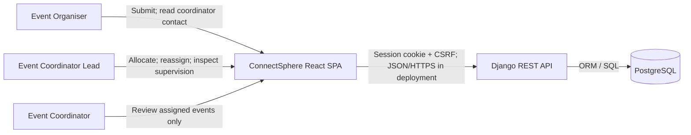
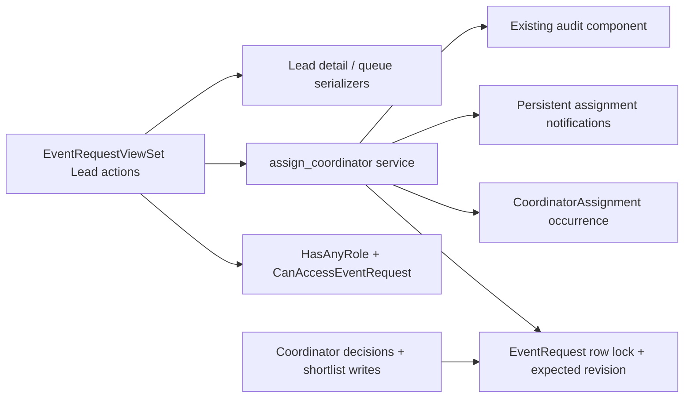

# Lead assignment architecture (SCRUM-89 / SCRUM-53)

This supplements the historical C4 exports. No container is added.

## Context and containers



## API components



One transaction encloses allocation, history, notices and response construction.
History uses protected account references and no update API. Old assignments
do not grant permissions. Notification recipient access does not grant event access.

## Concurrent assignment

```mermaid
sequenceDiagram
  participant L as Lead browser
  participant API as REST API
  participant DB as PostgreSQL
  L->>API: coordinator_id + expected_revision
  API->>DB: BEGIN; lock event
  API->>DB: Check fresh actor, target, status and revision
  alt revision differs
    API-->>L: 409; reload current assignment
  else current revision
    API->>DB: Save occurrence + owner + supervisor + revision
    API->>DB: Insert recipient notices; serialize; COMMIT
    API-->>L: Current detail and history
  end
```

See [implementation](../lead-assignment.md) for migration and integration contracts.
