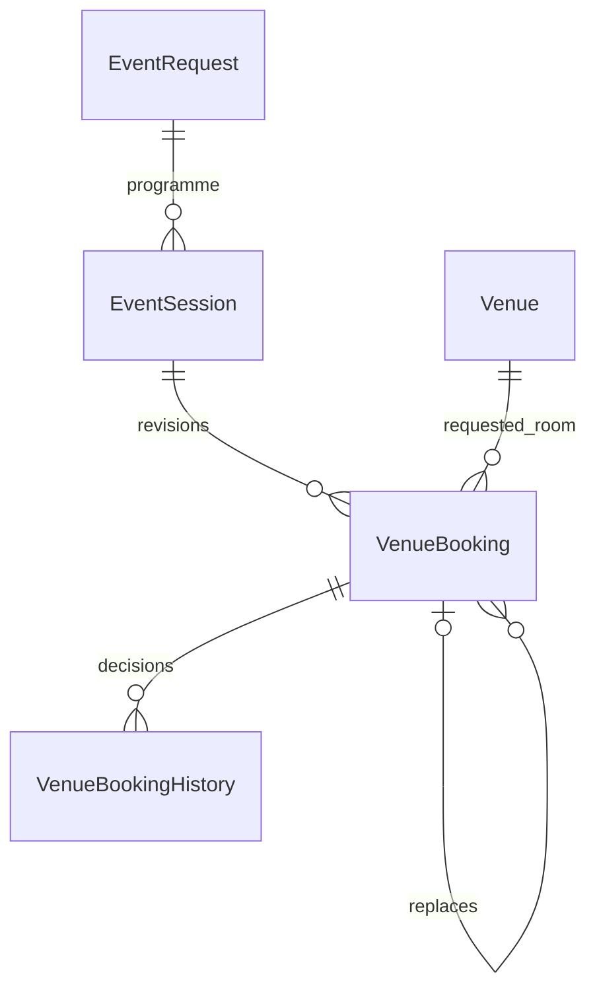

# Multi-venue sessions — SCRUM-87

Based on reviewed main `ef91b36375a98c7262d5cdf855b5ad313ce1d639` (PRs #27–31). This is the Sprint 4 SESSIONS gate; it publishes the identity used by later conflict, suitability, holds and approved-change work.



`EventSession` supplies stable event/name/kind identity and active/required flags. Main programme is always active and required. Booking revisions store their own explicit period, layout, facilities, access requirements and attendance. Main attendance is read from the event's current expected attendance; breakout attendance remains local. Updating the event never silently changes a breakout's period, attendance or room.

Existing bookings migrate into their event's main session, retaining IDs, decision records, timestamps and history. The PostgreSQL backfill drains deferred FK checks before making the session FK mandatory. The former one-approved-booking-per-event constraint becomes one approved booking per session. Data added after this migration can have several approved sessions; downgrading to the former single-room schema is not a supported rollback strategy once that happens.

Requests and decisions acquire the event lock first, venue rows in ID order, then booking rows. Approval reruns suitability and effective buffered occupancy. Only the exact original booking of an explicitly linked replacement is excluded from that replacement's preview; other sessions of the same event remain conflicts. Pending replacements occupy nothing. Staff approval withdraws the protected original and approves the replacement within one transaction. A conflict, stale original or notification/history failure rolls everything back. Ordinary requests and staff decisions require Approved/Planning; confirmed changes must enter the later approved-change workflow.

```mermaid
sequenceDiagram
    participant C as Assigned coordinator
    participant A as Booking API/services
    participant D as PostgreSQL
    participant V as Venue Staff
    participant S as Safety service
    C->>A: Request main/breakout or linked replacement
    A->>D: Lock event and venues; check suitability/occupancy
    A->>D: Persist Pending request + immutable history + staff notification
    V->>A: Approve one request
    A->>D: Reread under locks; validate current session/room
    opt Explicit replacement
        A->>D: Withdraw original with replacement reference
    end
    A->>D: Approve selected request + history
    A->>S: arrangements_changed inside transaction
    A->>D: Coordinator notification; commit
```

Withdrawal retains the required session. Readiness names any session still missing an approved booking, even when another session is approved. The coordinator may explicitly remove an inactive-arrangement breakout during planning, retaining all history and recording a field-change entry. The main programme cannot be removed. Event cancellation still releases all active room arrangements atomically.

Public confirmed-arrangement, registration and attendee projections include every approved room's session name, kind and explicit period. Staff decision notes and Safety facts remain internal. Safety's arrangement fingerprint includes active session identities so programme changes cannot reuse an obsolete review.

## Follow-on contracts

- SCRUM-66: use `Requirements.for_booking()`; main follows current event attendance, breakout remains independent. Do not overwrite breakout period/attendance in a blanket event edit.
- SCRUM-70: assess session-specific proposals; exclude only the explicitly replaced booking, never the entire event.
- SCRUM-88: extend the per-session protection, fresh occupancy predicate, removal guard, readiness and cancellation for held/expired states.
- SCRUM-80: create and approve replacements through the real workflow while preserving unaffected sessions. No generic Confirmed edit bypass was added here.
- SCRUM-87 AC5's full confirmed-change → review → Safety → reconfirmation closure remains a joint integration check at APPLY. Planning replacement, withdrawal and preservation are executable now.
