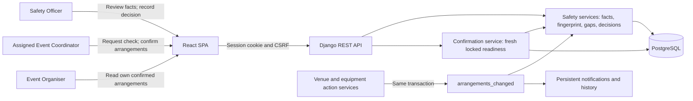

# Safety review and confirmation (SCRUM-90 / SCRUM-58)

This supplements the historical C4 exports. The existing React SPA, Django API and PostgreSQL containers remain. The Safety Officer is an internal actor with a review queue; organisers and attendees cannot read internal Safety checks. The Lead assigns work but cannot impersonate the assigned coordinator's confirmation action.



```mermaid
sequenceDiagram
  participant C as Coordinator
  participant V as Venue Staff
  participant T as Technical Support
  participant S as Safety Officer
  participant A as API / database
  V->>A: Approve venue booking
  T->>A: Reserve equipment or explicitly approve no-equipment plan
  C->>A: Request Safety check
  A->>A: Lock event; verify arrangements; snapshot facts
  A-->>S: Pending check notification
  S->>A: Approve, reject or request changes
  A->>A: Recheck fingerprint; retain officer, time and comment
  alt approved
    C->>A: Confirm event
    A->>A: Lock event and resource rows; recheck readiness and current Safety
    A-->>C: Confirmed metadata; organiser notice
  else changes needed
    A-->>C: Planning; officer comment
    C->>A: Revise arrangements; request fresh check
  end
  T->>A: Release equipment after confirmation
  A->>A: Same transaction: release, supersede Safety, return to Planning, record notices/history
  A-->>C: Fresh technical/Safety approvals required
```

`api/apps/safety/services.py` owns arrangement gaps, version fingerprints and supersession. `api/apps/safety/views.py` serves the scoped request/review endpoints. `api/apps/events/confirmation.py` owns final confirmation and organiser arrangement projection; `confirmation_views.py` enforces the HTTP role/organisation boundary. Confirmation locks event, venue and equipment rows in the shared order before evaluating current resources. Technical and venue actions retain their same-transaction invalidation hooks.

The actual Sprint 3 reserve/release/amend/withdraw/cancel actions exercise these hooks. The future SCRUM-80 approved change-request producer must call the same hook in Sprint 4. Setup/turnaround, expiring holds and multi-venue extensions remain outside this Sprint 3 diagram.

See [the final audit](../testing/sprint-3-final-audit-2026-11-03/README.md) and the real API/browser tests for execution evidence. Diagrams and automated results do not substitute for teammate review or PO acceptance.
