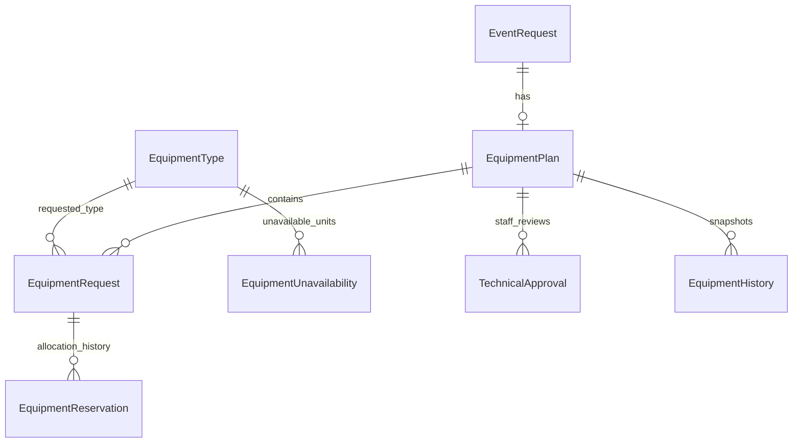

# Equipment foundation: SCRUM-16/77 enabling work (G03)

Branch: `feature/equipment-contract`. Base: approved main
`2fee7403ea324af1c71957735523bc10dbe7fcef`. Scope authorised 27 October 2026.

This publishes the shared equipment data contract for Shalika's requests,
Jerom's availability/Safety work, Adilah's amendments and Nethren's later
reservation/release actions. It does not complete SCRUM-16 or SCRUM-77.

## Source and scope

Checked live Jira SCRUM-16/77/12/74/75/76, the registered Drive PROJECT folder and
Customer Meeting document; Week 4 Project Instructions equipment rows and testing
rubric; Week 4 G3 answers D22/D45/D50/D55; Week 7 change 6; and the Project FAQ
19 October testing update. G03 in the agreed Sprint 3 guide defines this slice.
The Week 4 lesson, slides 21–26 and 32, supplies the case/expected-result approach.
The later Lead/Safety changes take priority over the older meeting's automatic
coordinator allocation. Slack was unavailable; no Slack update is claimed.

The team chose aggregate quantities (Week 4 D45 permits aggregate or individual
units). Catalogue maintenance uses Django admin and a repeatable demo seed.
No reservation, release, request or approval HTTP endpoint is added at this gate.
No Safety hook is stubbed and no application action reports a pretend success.

## Initial case specification

These groups were specified alongside implementation, initially Not Executed.
The [execution report](equipment-contract-test-evidence.md) and
[individual cases](test-cases/SCRUM-16-77-equipment-foundation.csv) now record
98 executed foundation cases and the 10 full-story ACs scheduled for later gates.

| Group | Input/action | Independent expected result |
|---|---|---|
| Stock | Total 10; active unavailable records of 1 damaged + 1 maintenance | Usable stock 8; expected return passing does not automatically restore either record. |
| Stock bounds | Total 0; record unavailable 1. Total 10; existing unavailable 2; reduce total to 1 | Refused without partial writes. Zero total with no unavailable records is valid. |
| Restore | Restore one unavailable unit, retaining reporter/reason/return estimate | Usable stock increases exactly 1; record and restoring actor/time remain. |
| Requests | Quantity 3, distinctive technical text, submitting coordinator | Fresh read retains exact values and identity/time; zero/negative quantities refused. |
| Request identity | Two active lines of same type on one plan; withdraw and re-request | Duplicate active line refused; withdrawn history preserved and new line permitted. |
| Periods | Aware start/end; equal/reversed/missing/naive inputs; boundary adjacency | Only aware positive intervals accepted; adjacent reservations do not overlap. |
| Reservations | Quantity 5 of requested 8; active, released and cancelled-event records | Only active reservations of non-cancelled events obstruct the half-open period. No over-allocation service is claimed. |
| Release record | Released state without user/reason/time; active state with release metadata | Inconsistent records refused; complete release retains exact quantity/actor/reason/time. |
| History | Before quantity 5, after 3, actor/time/revision | Both snapshots survive subsequent request updates; historical references cannot be deleted. |
| Technical approval | Explicit no-equipment acknowledgement; stale revision; supersession | Actor/time and revision retained; stale current approval refused; old superseded approval retained. |
| Stock concurrency | Two simultaneous unavailable records, quantity 6 each against stock 10 | Exactly one commits; the other refuses; active unavailable total remains 6. |
| Lock contract | Equipment IDs supplied out of order; competing PostgreSQL connection | Types lock in ID order inside a transaction; competing lock is refused. |
| Seed/upgrade | Fresh migration, repeat seed, edited catalogue | Valid fresh schema; no duplicate or overwritten stock; no fabricated requests, reservations or approvals. |

## Published schema

All models are in `api/apps/equipment/models.py`; all seven tables are introduced
by `equipment/0001_initial.py`. This PR owns only the equipment app's schema.
It does not compete with Shalika's venue/event migrations.

| Model | Shared fields and meaning |
|---|---|
| EquipmentType | Primary key, code, name, total_quantity, in_service. Zero stock is valid. Admin keeps an existing code read-only. |
| EquipmentUnavailability | equipment_type, positive quantity, cause (DAMAGED/MAINTENANCE), nonblank reason, optional aware expected_return_at, reported_by, created_at, restored_by/restored_at. Retain restored records. |
| EquipmentPlan | One per event; equipment-only revision, initially 0. Separate from Jerom's later event arrangement/Safety version. No plan or approval is automatically created by an event read. |
| EquipmentRequest | plan, equipment_type, positive quantity, technical_requirements, requested_by/requested_at; REQUESTED/RESERVED/WITHDRAWN. One non-withdrawn line per type/plan; multiple units use quantity. A request after withdrawal is a new row. |
| EquipmentReservation | request, positive quantity, aware starts_at/ends_at, ACTIVE/RELEASED, reserved_by/reserved_at, released_by/released_at/release_reason. One ACTIVE row per request; prior RELEASED rows remain on re-reservation. |
| TechnicalApproval | plan, plan_revision, approved_by/approved_at, no_equipment_required, notes, APPROVED/SUPERSEDED and superseded_at. At most one APPROVED row per plan. Prior approvals remain. |
| EquipmentHistory | plan, optional request/reservation, action, plan_revision, JSON-object before/after snapshots, actor, reason and timestamp. Snapshots retain previous quantities/requirements after the current row changes. |

Event lookup paths are `request.plan.event` and `reservation.request.plan.event`.
These relations and historical user references use PROTECT. Workflow/history
records are read-only in admin; direct event deletion cannot erase them.
History's request/reservation must belong to the same plan and, when both are
supplied, the same request.

Database constraints enforce positive quantities/periods, known states, active
uniqueness and complete release/supersession metadata. Model full_clean() also
checks cross-record consistency and fresh request/plan versions. Django does not
call it automatically from save(); future services must call it inside their
locked transaction. Raw ORM operations are internal tools, not authorised APIs.

## Functions available now

| Function / query | Contract |
|---|---|
| contracts.validate_quantity(quantity) | Genuine positive integer; reject booleans, strings, fractions, zero and negatives before model-field conversion. |
| contracts.validate_period(start, end) | Aware datetime instants, end strictly after start. Actual event periods, without venue buffers. |
| contracts.lock_equipment_types(ids) | Existing positive integer IDs; deduplicate and lock ascending IDs inside the caller's transaction. Invalid/missing IDs refuse. |
| EquipmentReservation.objects.active().overlapping(start, end) | ACTIVE reservations of non-cancelled events intersecting the half-open interval. RELEASED and cancelled-event rows remain historical. |
| inventory.save_equipment_type(instance) | Lock an existing type; validate total stock against recorded unavailable units; save atomically. |
| inventory.save_unavailability(instance) | Lock/reread type; require reason; aggregate active unavailable stock ≤ total. Type cannot change; restored records cannot be rewritten. |
| inventory.restore_unavailability(record, actor) | Retain record and restoring actor/time. Repeating it does not increase stock twice. |

Inventory maintenance is usable through Django admin with Django's staff/model
permissions. These functions are not reservation/release APIs and do not grant
Technical Support general event access.

### Later action services

1. Lock the event first, then venues in ID order where relevant, then equipment
   types in ID order, then request/reservation rows. All stock/resource writers
   use the same type lock. Lock plain event rows without nullable joins.
2. Resolve actors from authentication and reread assignment. Shalika's request
   action permits only the current coordinator; technical actions need active
   Technical Support. Client-supplied staff IDs/statuses/audit fields confer no authority.
3. Create/get the plan after the event lock. Requirement/reservation/release
   changes increment its revision and supersede any current TechnicalApproval
   atomically. Check an observed revision to reject stale edits. Persist history
   and recipient notices in the same transaction; retries must not duplicate them.
4. Reservations copy the actual period from the locked event and recheck current
   requests, usable stock and allocations. This foundation does not implement
   the over-allocation calculation or reservation action.
5. Jerom's availability must use concurrent occupancy: usable stock 10 with
   reservations of 5 at 09:00–10:00 and 6 at 10:00–11:00 leaves **4** available
   throughout 09:00–11:00, not -1. Use peak simultaneous reserved quantity,
   preserve half-open adjacency and exclude unusable stock. Expected return
   dates do not automatically restore stock.
6. Safety readiness requires a current approval matching the plan revision and
   actual sufficient active reservations for each required line. An empty plan
   requires explicit staff acknowledgement with no_equipment_required=True.
   Record validity alone is not a readiness decision; no model declares an event ready.
7. Equipment actions must call Jerom's real arrangements_changed(event, reason,
   actor) service once G04 exists. Stock changes affecting live allocations also
   need resource-impact/readiness checks. Do not add a silent no-op Safety hook.
8. G16b cancellation must actually release equipment and venue occupancy, retain
   history and notify users atomically. Cancelled-event query exclusion is a read
   rule, not evidence that the cancellation action exists.
9. Later views enforce Technical Support or assigned-coordinator access without
   leaking another event's protected details.

## Demo and maintenance

Run migrations, then `python manage.py seed_demo_data`; it now calls
`seed_equipment_catalogue`. The standalone command requires an existing active
Technical Support account. Samples: Projector (10 total / 2 damaged),
Wireless microphone (12 / 1 maintenance) and Portable speaker (4 / 0).
Repeated seeding preserves edited quantities, retired types and restored records.
It creates no equipment plan, request, reservation or approval.

Create a staff/superuser account with the existing Django management commands
when needed, then visit /admin/equipment/. Stock/unavailable-stock entries are
editable; restoration retains reason/reporter and records restoring actor/time.
Workflow/history records are view-only. A concurrent stock-validation conflict
returns an admin error and reload rather than a 500. The ordinary demo Technical
Support account is not silently granted admin rights.

## Architecture

No container or SPA route is added. The existing equipment Django component owns
this persistence and inventory-maintenance contract.

## Handoff

After this branch is reviewed, merged and main CI passes, Shalika, Jerom and
Adilah fetch and merge that main into their own feature branches. Foundation
records do not establish end-to-end story acceptance. SCRUM-16/77 stay open.
Shalika imports EquipmentPlan/EquipmentRequest at G14; Jerom consumes stock and
reservation records at G04/G15/G18; Adilah uses retained status/history at G17;
Nethren adds actual reserve/release actions at G16a/G16b. Coordinate equipment
schema changes through this contract.
